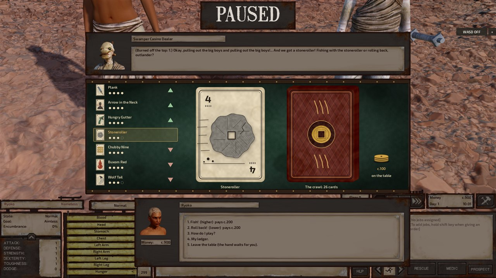
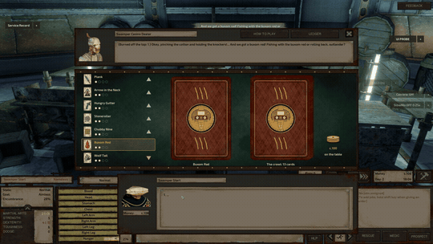
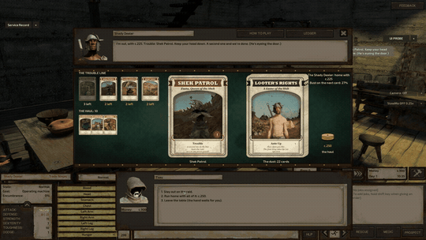
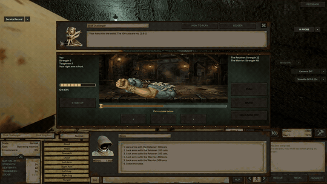

# PZA's Cat Crawlers & Bar Games for Meitou

Three playable Kenshi bar games for [MeitouClient](https://github.com/Meitou-Modding-Ecosystem/MeitouClient) (`>=0.21.0`), built into Kenshi's own conversation-panel style with custom card and arm-wrestling art. Author: **PZA**. Licence: **GPL-3.0-or-later**.



## Games Included

### 1. Cat Crawlers (Shark & Mud Town)


Talk to any **Swamper Casino Dealer** and say yes (`"Sure, why not."`), or hold right-click on him and choose **Play Cat Crawlers** (F10 > Mods also offers a seat at the nearest dealer).
- 28-card crawl (7 crawlers, 4 copies each) with a live card-counting ladder.
- Call **Fish!** (higher) or **Roll back!** (lower); payouts scale with the odds.
- Take the pot or let it ride on a **Hot chain**.
- Dealer lines are read at run time from your own game files in your game's language — no Kenshi dialogue text is shipped.

### 2. Looter's Rights (The Hub)


Find the **Shady Dealer** at the Hub's bar and say **"Deal me in."**
- Press-your-luck Dust Bandit card game: ante up, draw loot onto the haul, and watch the trouble line.
- Two matching trouble cards bust everyone still out; run home early for half the haul, or be the last one out to take the rest.
- The Dust King takes the best card off the haul.

### 3. Shek Arm Wrestling (Squin)


Find the **Shek Challenger** at Squin's bar and say **"Lock arms."**
- Real-time grip contest scaled by your character's Strength and Toughness.
- **PUSH**, **BRACE** against telegraphed surges, hit directional Grit Surge sequences, or toggle **HOLD PUSH** for steady pushing without mashing.
- Awards Strength/Toughness XP and Shek Kingdom respect on first wins per tier.

## Compatibility
- Requires **MeitouClient 0.21.0 or newer** (tested through 0.22.2 nightlies).
- Works alongside **PZA's WASD & Controller Support** — no conflicting hotkeys; every action is a list row or clickable button.
- Your ledger and in-progress hands are saved in the mod's own sidecar file; vanilla saves stay untouched.

## Build from Source

Requires the .NET SDK, an unpacked MeitouClient release (`>=0.21.0`), and [PZAMeitouUi](https://github.com/Meitou-Modding-Ecosystem/PZAMeitouUi) cloned beside this repository (`..\PZAMeitouUi`).

```powershell
.\mod\build.ps1 -MeitouDir <path-to-meitou>        # builds and stages mod\out\PZACatCrawlers\
.\mod\build.ps1 -Fuzz -MeitouDir <path-to-meitou>  # builds and runs the fuzz harness (tests\fuzz)
```

## Automated checks

GitHub Actions builds and stages the mod and runs its existing full fuzz suite separately on official Meitou 0.21.0 and 0.22.1 Windows releases. The 0.22.1 job also runs the existing mutation gate. Reader ZIP hashes and the shared UI/fuzz-kit commit are pinned. The required `Development readiness` check succeeds only when both jobs pass; it publishes nothing and needs no Kenshi installation or secrets. Run the same checks locally with `pwsh Tools/CI.ps1 -MeitouVersion 0.22.1 -MeitouDir <extracted-release> -Scratch <scratch-directory> -Mutation`, with the shared UI checkout beside this repo. These automated checks do not replace interactive gameplay testing.

## Licence

GNU General Public License v3.0 or later — see [LICENSE](LICENSE) and [NOTICE.md](NOTICE.md).
Ideas and pull requests are welcome.
